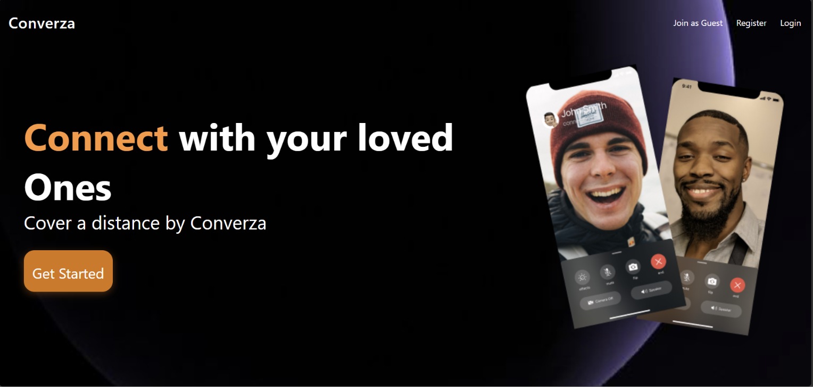
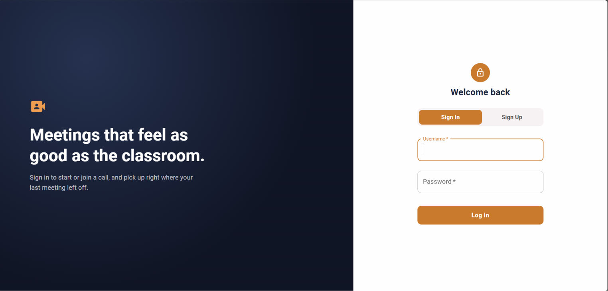
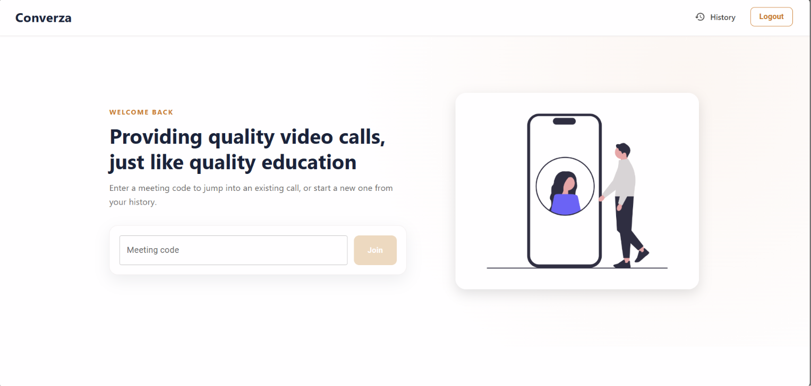
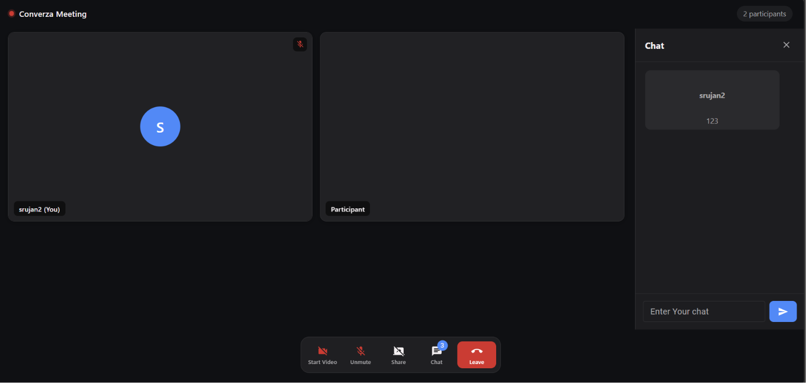
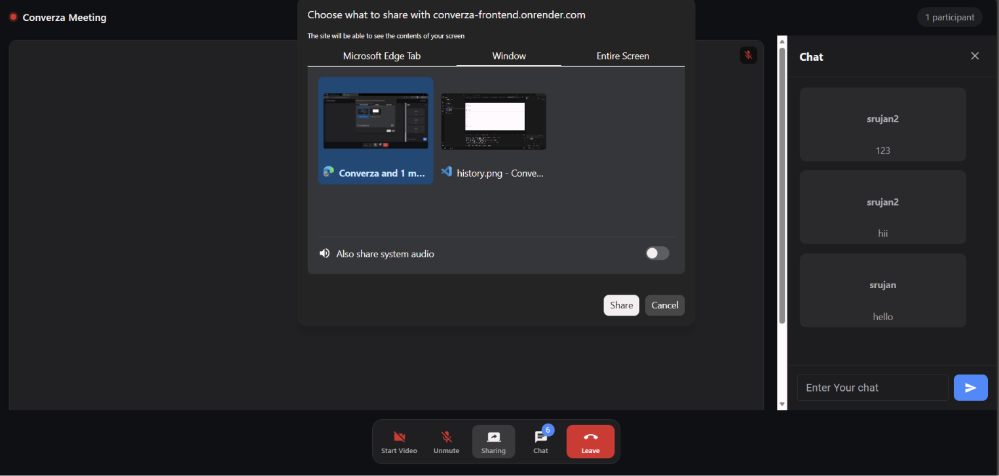
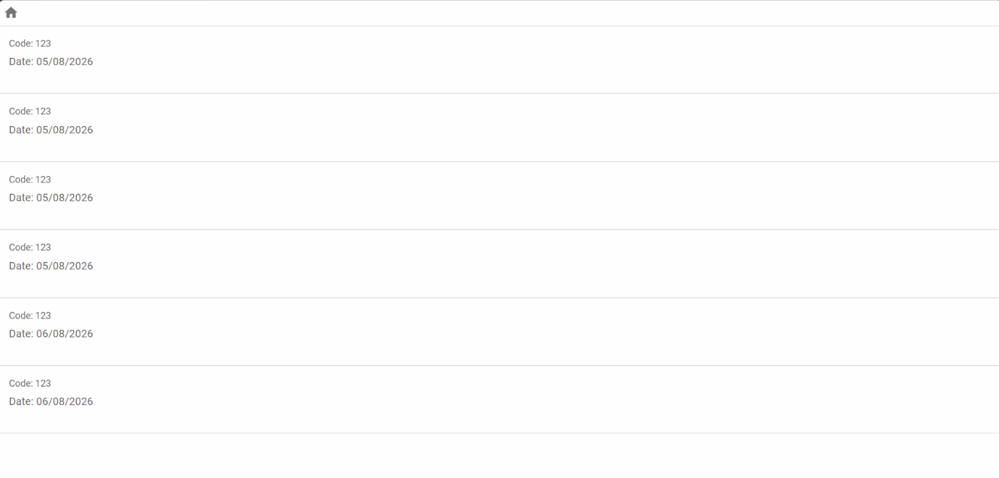

# 🎥 Converza

<div align="center">

### A Modern Real-Time Video Conferencing Platform

Build secure video meetings, collaborate through live chat, share your screen, and connect instantly from anywhere.

**Live Demo (peer-to-peer):** https://converza-frontend.onrender.com
**Live Demo (mediasoup SFU, AWS EC2):** https://converza.duckdns.org


</div>

---

## 📖 Overview

**Converza** is a full-stack real-time video conferencing web application built using the **MERN Stack**, **WebRTC**, and **Socket.IO**.

The platform enables users to create or join meetings instantly, communicate through high-quality video and audio, share screens, exchange messages in real time, and maintain a history of previous meetings.

Media can travel two ways. On a server that can receive media traffic, a **mediasoup SFU** forwards video, so each participant uploads their camera **once** no matter how many people join. Anywhere else, meetings automatically fall back to the original **peer-to-peer mesh**. Both paths are covered by automated tests and were load-tested side by side (see [Performance](#performance)).

---

# ✨ Features

### 🔐 Secure Authentication
- User Registration
- User Login
- Password encryption using **bcrypt**
- Guest meeting access: display name + meeting ID, no account needed

### 📹 HD Video Conferencing
- Multi-user meetings through a **mediasoup SFU**, with automatic peer-to-peer fallback
- Camera On/Off and Microphone Mute/Unmute
- Participants' names on every video tile
- Camera-off avatar and muted icon shown to others (SFU mode)

### 🖥 Screen Sharing
- Share your screen instantly, shown to everyone in a full-screen spotlight
- The presenter's microphone stays on while sharing
- Stopping from the browser's own "Stop sharing" bar is handled too

### 💬 Real-Time Chat
- Instant messaging during meetings
- Socket.IO powered communication
- Chat is cleared when a meeting ends, so a reused meeting code starts fresh

### 👥 Meeting Management
- Create meetings
- Join meetings using Meeting ID
- Share meeting links with participants
- Meetings are isolated: media and signaling are only relayed within the same meeting

### 📜 Meeting History
- View previous meetings
- Track activity after login
- Persistent storage using MongoDB

### ⚡ Modern User Experience
- Responsive Interface
- Material UI Components
- Clean Navigation
- Fast React Rendering

---

# Architecture

```
                 Peer-to-peer mesh (fallback)            mediasoup SFU
                 each person sends to everyone           each person sends once

                      A ◄────► B                          A ─┐         ┌─► A
                      ▲ ╲    ╱ ▲                          B ─┼─► SFU ──┼─► B
                      │  ╲  ╱  │                          C ─┤         ├─► C
                      ▼  ╱  ╲  ▼                          D ─┘         └─► D
                      C ◄────► D
              uploads per person: N − 1                uploads per person: 1
```

1. The meeting page asks the server `sfu:status`. If the SFU is running, media goes through it; otherwise the page uses peer-to-peer.
2. Everyone joins the same Socket.IO meeting room with `join-call`. Names, chat and screen-share status work the same in both modes.
3. In SFU mode each browser opens two WebRTC transports to the server (send and receive), sends its camera and mic as **producers**, and receives everyone else as **consumers**. The server decides which meeting a socket belongs to, so a browser can't request media from another meeting.

| Part | Where |
|---|---|
| SFU workers, rooms and signaling | `backend/src/sfu/` |
| Browser SFU client | `frontend/src/sfu/sfuClient.js` |
| Meeting page (both modes) | `frontend/src/pages/VideoMeet.jsx` |
| Meeting rooms, chat, names | `backend/src/controllers/socketManager.js` |

---

# Performance

Same frontend build, measured with the backend SFU on and off. Headless Chrome participants with a fake camera, 3 runs per size, median shown. All participants ran on one laptop (Ryzen 5 7520U, 8 threads, 7.3 GB RAM). Full tables with ranges are in [loadtest/results/REPORT.md](loadtest/results/REPORT.md).

| People | Videos each person uploads (mesh → SFU) | Upload per person | Received fps | Picture | Remote video frozen | Laptop CPU |
|---|---|---|---|---|---|---|
| 2 | 1 → 1 | 1.73 → 1.73 Mbps | 30 → 30 | 480p → 480p | 0% → 0% | 45% → 45% |
| 4 | 3 → 1 | 5.11 → 1.73 Mbps | 29 → 30 | 480p → 480p | 0% → 0% | 95% → 61% |
| 5 | 4 → 1 | quality collapsing → 1.73 Mbps | 20 → 30 | 348p → 480p | 31.5% → 0% | 94% → 78% |
| 6 | 5 → 1 | quality collapsing → 1.60 Mbps | 17 → 26 | 264p → 480p | 21% → 0.4% | 96% → 100% |

- With the mesh, the first participant opened up to **36 peer connections** in an 8-person room; with the SFU it's **4** (2 stay open).
- The SFU server used about **31% of one CPU core** for a 5-person meeting.
- Because one laptop runs every participant, it becomes the bottleneck at 6–8 people in both modes. These numbers compare the two designs; they aren't a promise of how many users a real deployment supports.

**Verified on the real deployment:** the same checks above were run against the live AWS EC2 server (a `t3.micro`: 2 vCPUs, 1 GB RAM) over the public internet, not localhost. At 4 real participants: 30 fps, 480p, 0 freezes, and the SFU server itself used only 7.4% of one CPU core. Raw results: [loadtest/results/ec2-live-2026-10-18.json](loadtest/results/ec2-live-2026-10-18.json).

---

# 🛠 Tech Stack

## Frontend

- React.js
- React Router
- Material UI (MUI)
- Axios
- Socket.IO Client
- WebRTC APIs
- mediasoup-client

---

## Backend

- Node.js
- Express.js
- Socket.IO
- mediasoup (SFU)
- MongoDB
- Mongoose
- bcrypt
- dotenv

---

## Testing

- Puppeteer with headless Chrome and a fake camera
- mongodb-memory-server for full-app tests

---

## Deployment

- Frontend: Render
- Backend: Render (peer-to-peer mode)
- Database: MongoDB Atlas
- SFU deployment: AWS EC2 with Nginx, Let's Encrypt HTTPS and pm2 ([deploy/README.md](deploy/README.md))

---

# 📂 Project Structure

```
Converza
│
├── frontend
│   ├── public
│   ├── src
│   │   ├── pages            # landing, auth, home, history, guest, VideoMeet
│   │   ├── contexts
│   │   ├── utils
│   │   ├── sfu              # browser side of the SFU
│   │   └── App.js
│   │
│   └── package.json
│
├── backend
│   ├── src
│   │   ├── controllers      # REST handlers, socketManager (meeting rooms)
│   │   ├── models
│   │   ├── routes
│   │   ├── sfu              # mediasoup workers, rooms, signaling, stats
│   │   └── app.js
│   │
│   └── package.json
│
├── deploy                   # EC2 setup script, Nginx and pm2 config
├── loadtest                 # load tests, feature checklist, full-app tests, results
├── sfu-lab                  # standalone mediasoup prototype + backend SFU checks
└── README.md
```

---

# 🚀 Live Demo

### 🌐 Application

- Peer-to-peer mesh (Render): https://converza-frontend.onrender.com
- mediasoup SFU (AWS EC2): https://converza.duckdns.org

---

# ⚙ Installation

## Clone the Repository

```bash
git clone https://github.com/Srujan-017/Converza.git

cd converza
```

---

## Backend Setup

```bash
cd backend

npm install
```

Create a `.env` file (see `backend/.env.example`):

```env
MONGODB_URI=your_mongodb_connection_string
PORT=8000
# Optional: use the SFU instead of peer-to-peer
SFU_ENABLED=true
```

Run backend:

```bash
npm run dev
```

---

## Frontend Setup

```bash
cd frontend

npm install
```

Create a `.env` file:

```env
REACT_APP_SERVER_URL=http://localhost:8000
```

Run frontend:

```bash
npm start
```

---

# 🌍 Environment Variables

## Backend

```env
PORT=8000

MONGODB_URI=your_mongodb_connection_string

# SFU (optional, off by default)
SFU_ENABLED=true
MEDIASOUP_LISTEN_IP=127.0.0.1          # 0.0.0.0 on a cloud server
MEDIASOUP_ANNOUNCED_ADDRESS=           # the server's public IP on a cloud server
MEDIASOUP_MIN_PORT=40000
MEDIASOUP_MAX_PORT=49999
```

## Frontend

```env
REACT_APP_SERVER_URL=http://localhost:8000
```

---

# 🔄 Application Workflow

```text
Login / Register            Join as Guest
        │                         │
        ▼                         ▼
   Home: meeting code      Name + meeting ID
        │                         │
        └──────────┬──────────────┘
                   ▼
        Meeting room /<meetingId>
                   │
                   ▼
   Socket.IO room (join-call, names, chat)
                   │
          SFU available?
        ┌──────────┴──────────┐
        ▼                     ▼
   mediasoup SFU        Peer-to-peer mesh
        └──────────┬──────────┘
                   ▼
  Video, audio, screen share, chat
                   │
                   ▼
    Meeting history saved (logged-in users)
```

---

# 📡 API Endpoints

## Authentication

| Method | Endpoint |
|---------|----------|
| POST | `/api/v1/users/register` |
| POST | `/api/v1/users/login` |

---

## Meeting Activity

| Method | Endpoint |
|---------|----------|
| POST | `/api/v1/users/add_to_activity` |
| GET | `/api/v1/users/get_all_activity` |

---

## Status

| Method | Endpoint | Returns |
|---------|----------|---------|
| GET | `/api/v1/health` | API, database and SFU status |
| GET | `/api/v1/sfu/stats` | SFU totals (workers, CPU time, rooms, peers); no meeting codes |

---

# Testing

All tests use real headless Chrome participants with a fake camera.

```bash
cd loadtest
npm install

# Whole app on an in-memory MongoDB: register, login, meeting, guest, history, logout
npm run e2e

# Meeting features (backend + production frontend build running)
node features.mjs --mode sfu
node features.mjs --mode mesh

# Load test and comparison report
node run.mjs --sizes 2,4,6 --repeat 3 --label sfu --api http://localhost:8000
node report.mjs results/<mesh>.json results/<sfu>.json --out results/REPORT.md
```

```bash
# Backend SFU signaling checks (no MongoDB needed)
cd sfu-lab
npm install
npm run check-backend
```

See [loadtest/README.md](loadtest/README.md) for details.

---

# 💡 Key Highlights

- Full Stack MERN Application
- mediasoup SFU with automatic peer-to-peer fallback
- Measured mesh vs SFU with repeated, automated load tests
- Socket.IO Signaling with meeting isolation
- Secure Authentication
- Screen Sharing with the presenter's mic kept live
- Automated end-to-end and feature tests
- AWS EC2 deployment with Nginx, HTTPS and pm2
- Meeting History Tracking

---

# 🔮 Future Enhancements

- Simulcast, so thumbnails receive smaller video
- TURN server for very restrictive networks
- Meeting Scheduling
- Waiting Room
- Virtual Backgrounds
- Meeting Recording
- Live Captions
- File Sharing
- Emoji Reactions
- Admin Dashboard
- AI Meeting Summaries
- End-to-End Encryption

---

# 📸 Screenshots

Experience Converza through its clean, modern, and intuitive interface.

| Landing Page | Login Page |
|--------------|------------|
|  |  |

| Home Dashboard | Chat Panel |
|----------------|------------|
|  |  |

| Screen Sharing | Meeting History |
|----------------|-----------------|
|  |  |

> **Note:** The Video Meeting screenshot will be added in a future update.

# 🤝 Contributing

Contributions, issues, and feature requests are always welcome.

1. Fork the repository
2. Create a new feature branch

```bash
git checkout -b feature-name
```

3. Commit your changes

```bash
git commit -m "Added new feature"
```

4. Push to your branch

```bash
git push origin feature-name
```

5. Open a Pull Request

---

# 👨‍💻 Developer

**Srujan V**

Passionate Full Stack Developer focused on building scalable web applications and real-time communication platforms using modern technologies.

GitHub: https://github.com/Srujan-017

---

# ⭐ Support

If you found this project useful, consider giving it a ⭐ on GitHub.

It motivates future development and helps others discover the project.

---

## 📄 License

This project is licensed under the MIT License.

```
MIT License

Copyright (c) 2026 Srujan V

Permission is hereby granted, free of charge,
to any person obtaining a copy of this software...
```

---

<div align="center">

### ⭐ Thank you for visiting Converza!

Built with ❤️ using React, Node.js, MongoDB, Socket.IO, WebRTC and mediasoup.

</div>
